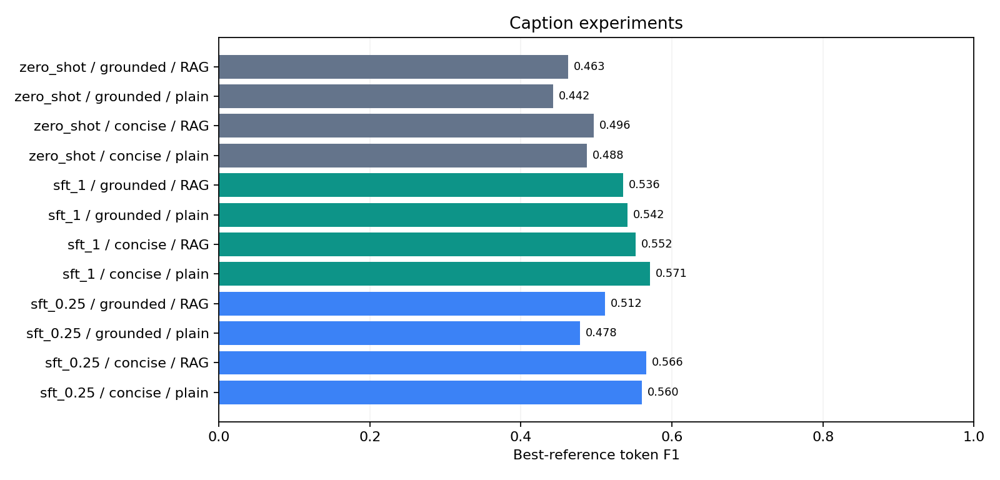

# 基于 CLIP + Qwen-VL 的图文检索与多模态指令微调研究

在单张 16GB GPU 上完成可复现的小规模研究：Flickr8k 双向检索 → Qwen2.5-VL 图像描述基线 → LoRA 指令微调 → 提示词/样本比例/检索增强消融。

**实验范围：**这是教学与工程验证规模的子集实验，不代表 Flickr8k 全量基准，也不能据此宣称模型普遍优于其他系统。实际结果见 [实验报告](reports/results.md)，运行记录见 [项目状态](reports/status.md)。

## 已完成的真实实验

12 组评估、768 条预测、两个 LoRA adapter 已完成；9 项测试和完整性核验通过。

|设置（concise，无 RAG）|Token-F1|ROUGE-L|
|---|---:|---:|
|zero-shot|0.4877|0.4628|
|LoRA，25% 图像|0.5602|0.5402|
|LoRA，100% 图像|0.5711|0.5566|

主对比 Token-F1 提升 8.34 个百分点，图像级配对 bootstrap 95% 区间为 [5.17, 11.59] 个百分点。RAG 的影响依赖配置，完整样本微调后并未继续提升主设置指标。



## 方法与数据

- 数据：[jxie/flickr8k](https://huggingface.co/datasets/jxie/flickr8k)，沿用公开 train/validation/test 划分，固定种子 42 抽取 128/32/64 张图像。流式 shuffle 使用 1024 条缓冲区，因此不是全量均匀抽样。
- 每张训练图像取前两条人工描述，转换为 256 条英文图像描述 instruction；验证损失使用首条描述，测试指标使用全部可用描述。
- 对 RGB 像素与尺寸计算 SHA256，阻止同图跨集合。仅检查完全相同内容，不保证消除近重复，也不能排除基础模型预训练见过 Flickr8k。
- CLIP：`openai/clip-vit-base-patch32`，L2 归一化后计算余弦相似度；image→text 接受任一同图描述，text→image 接受所属图像，报告 Recall@1/5/10。
- Qwen：`Qwen/Qwen2.5-VL-3B-Instruct`，BF16 + SDPA，图像最多 100352 像素，确定性生成最多 64 tokens。
- 此处 zero-shot 指不做本项目数据集适配；基础模型本身已经经过通用指令训练。LoRA 仅用 concise、无 RAG 的指令训练，再在两种提示词和 RAG 条件下评测同一个 adapter。
- LoRA：语言注意力 q/k/v/o 投影，rank=8、alpha=16、dropout=0.05；两轮、学习率 1e-4、microbatch=1、梯度累计 8、梯度检查点。仅 assistant 回答与结束标记参与损失，视觉/用户提示部分不参与损失。
- 只按验证损失选择 checkpoint；测试集不参与训练和选模。
- 检索增强：查询图像与训练图像 CLIP embedding 相似度，取前两张训练图像的首条描述。测试描述从不进入提示词。
- 25%/100% 按图像抽样，子集嵌套。固定两轮意味着训练步数随样本数变化，此比较包含数据量和计算量影响。RAG 库始终使用全部 128 张训练图像，因此 RAG 组衡量固定外部记忆条件下的适配效果。

## 安装

推荐 Python 3.10/3.11，以及支持显卡架构的 CUDA PyTorch。当前实测环境为 Windows、RTX 5070 Ti、PyTorch 2.11.0+cu128。不要直接使用系统中的 Python 3.7。

```powershell
python -m venv .venv
.\.venv\Scripts\Activate.ps1
python -m pip install torch torchvision --index-url https://download.pytorch.org/whl/cu128
python -m pip install -r requirements.txt
```

本目录已有 `.venv` 时可直接使用其 Python。首次运行需要下载数据和模型，Qwen 权重约数 GB；保证足够磁盘空间。下载缓存留在项目内，不纳入 Git。

## 运行

```powershell
# 国内网络必要时可设置镜像，海外可省略
$env:HF_ENDPOINT = 'https://hf-mirror.com'
$env:HF_HUB_DISABLE_XET = '1'

# 下载固定版本模型，校验 LFS SHA256；本地模型会被配置自动选用
python scripts/download_models.py

# 全流程，遇到错误立即停止
python scripts/run_all.py
```

若镜像的大权重链接跳回无法连接的主站，可设置 `$env:QWEN_MODELSCOPE = '1'` 再运行下载器；程序使用官方 ModelScope 分块读取 Qwen 权重，并与固定 Hugging Face 版本的 LFS SHA256 比对。已有数据可用 `python scripts/run_all.py --prepared` 跳过数据重新抽样。

也可以按阶段运行：

```powershell
python -m mmresearch.cli prepare
python -m mmresearch.cli retrieve
python -m mmresearch.cli evaluate
python -m mmresearch.cli train --fraction 0.25
python -m mmresearch.cli train --fraction 1
python -m mmresearch.cli evaluate --adapter outputs/sft_1/adapter
python -m mmresearch.cli evaluate --adapter outputs/sft_1/adapter --prompt grounded --rag
python -m mmresearch.cli report
python -m mmresearch.cli infer --image 'D:/path/to/image.jpg' --adapter outputs/sft_1/adapter
python -m unittest discover -s tests -v
python scripts/verify_run.py
python scripts/search.py --text 'A dog playing outside' --top-k 5
python scripts/search.py --image 'D:/path/to/image.jpg' --top-k 5
```

默认 12 组实验：{zero-shot, SFT25%, SFT100%} × {concise, grounded} × {plain, RAG}。`--split validation` 可用于验证集调试。更改样本或模型配置后，应重新生成检索缓存与所有评估，避免混合不同配置的实验。

## 指标解释

生成任务使用大小写无关、英文单词/数字分词的 Token-F1 和 ROUGE-L F1，对每张图取各参考答案得分的最大值后求平均。它们衡量词汇重合，不能替代事实一致性、幻觉率或人工评审；不使用不适合开放式描述的分类 accuracy。分数范围为 0–1。

小样本、单随机种子的结果只能提供方向性证据。SFT 可能降低指标；所有比较如实记录，不预设微调或 RAG 必然有效。后续正式研究可增加样本、随机种子、CIDEr/SPICE 和盲评。

## 文件说明

```text
configs/small.json       实验参数
mmresearch/data.py      数据/指令构建、图像级抽样
mmresearch/retrieval.py CLIP embedding、双向检索、训练集记忆库
mmresearch/vl.py        多模态输入、assistant-only loss mask
mmresearch/train.py     PEFT LoRA、验证选模、adapter 保存
mmresearch/evaluate.py  批量推理、逐样本预测、指标与运行信息
mmresearch/report.py    实验 CSV、图表与训练/验证曲线
scripts/run_all.py      完整实验编排
tests/                 指标与数据划分检查
reports/               可公开的实验报告和简历总结
data/                  本地数据与权重（Git 忽略）
outputs/               adapter、预测和日志（Git 忽略）
```

模型卡与数据集有各自使用条件。Flickr8k 镜像卡未完整说明许可；本仓库不重新分发图像或基础模型，使用原始下载来源，公开项目时应再次核对数据原始条款。

## 参考

- [CLIP 模型卡](https://huggingface.co/openai/clip-vit-base-patch32)
- [Qwen2.5-VL 模型卡](https://huggingface.co/Qwen/Qwen2.5-VL-3B-Instruct)
- [PEFT LoRA 文档](https://huggingface.co/docs/peft/package_reference/lora)
- [Flickr8k 数据源](https://huggingface.co/datasets/jxie/flickr8k)

GitHub 仓库：[wuweizao/CLIP-Qwen-VL](https://github.com/wuweizao/CLIP-Qwen-VL)。仓库只收录代码、配置和 reports；数据、缓存、基础模型和 adapter 保留本地，不纳入 Git。
