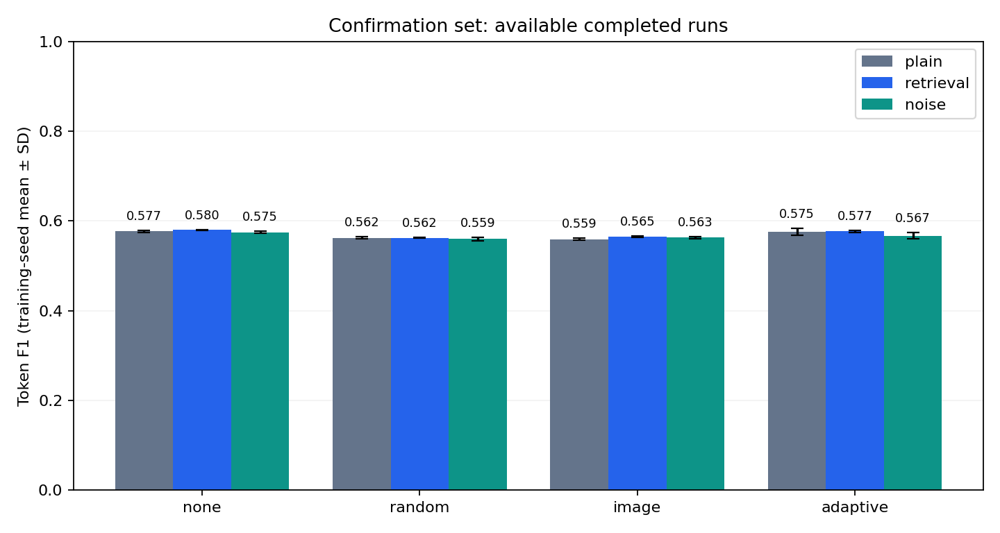
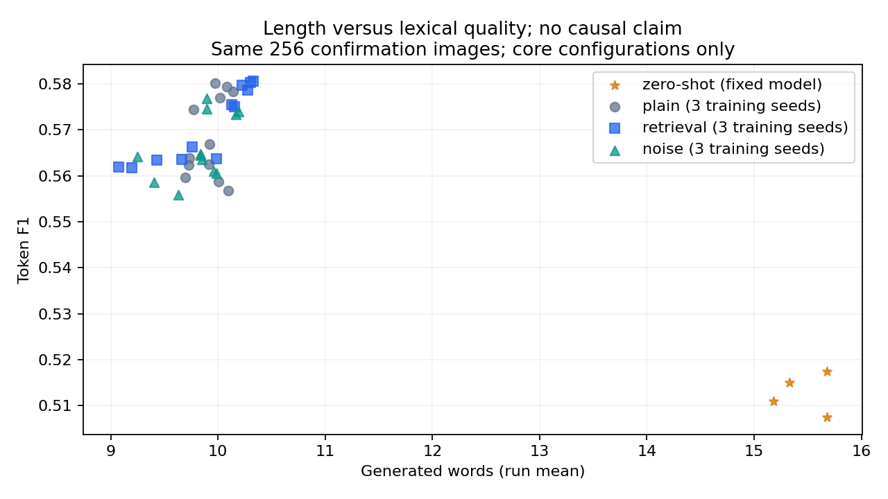
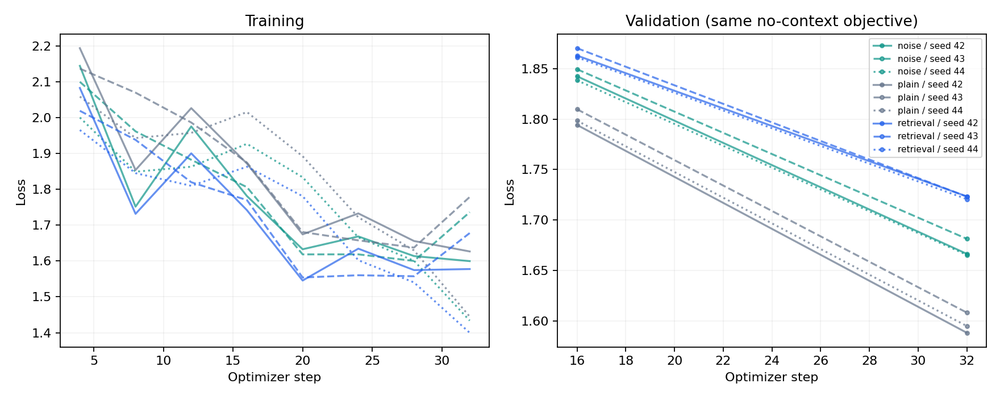
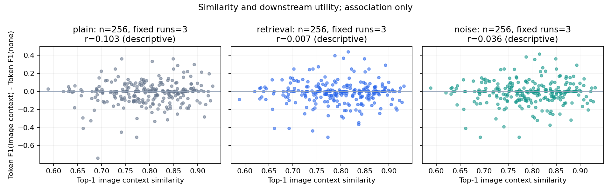

# 多模态检索干扰研究：实际实验结果

本报告只汇总已经写入完整预测与指标的运行。空白或 pending 不代表零分。

- 主对照完成：36/36；已完成评估运行：136；已保存 adapter：24。
- 人工相关性核验与盲评：pending。本报告没有把自动评分当作人工判断。
- 预先固定的协议见 [protocol.md](protocol.md)；逐运行数据见 [experiments.csv](experiments.csv)。

## CLIP 双向检索

候选池为 512 张新测试图像和 2560 条描述。图像检索描述时任一同图描述均为正例；描述检索图像时所属图像为正例。此任务覆盖完整新测试图库，与 256 张生成确认集及训练集 RAG 记忆库分别计量。

|方向|Recall@1|Recall@5|Recall@10|
|---|---:|---:|---:|
|image→text|0.7930|0.9453|0.9785|
|text→image|0.6316|0.8844|0.9484|

候选池规模不同的 Recall 不直接比较；本表不把检索 Recall 当作描述生成的事实正确率。

## 完成的确认集与预先固定诊断子集对比

数值为可用训练种子的均值 ± 样本标准差；仅一个种子时不估计种子方差。Zero-shot 为固定基础模型，不计作独立训练种子。

|训练方案|采样/图像数/预算|上下文|Bank|图像数|种子数|Token-F1|CIDEr-D变体|CLIPScore|输出词数|检索使用率|
|---|---|---|---|---:|---:|---:|---:|---:|---:|---:|
|noise|random/128/language/epochs|adaptive|full|256|3|0.5668 ± 0.0070|0.9743 ± 0.0094|0.8018 ± 0.0010|9.8971 ± 0.0606|0.7500 ± 0.3857|
|noise|random/128/language/epochs|conflict|full|64|1|0.5484|0.8938|0.8096|10.6250|1.0000|
|noise|random/128/language/epochs|image|full|256|3|0.5629 ± 0.0020|0.9647 ± 0.0030|0.8020 ± 0.0012|9.8932 ± 0.0825|1.0000 ± 0.0000|
|noise|random/128/language/epochs|image|full_length_matched|64|1|0.5434|0.9201|0.8091|10.3281|1.0000|
|noise|random/128/language/epochs|image|subset|64|1|0.5112|0.8061|0.8057|10.8750|1.0000|
|noise|random/128/language/epochs|image|subset_length_matched|64|1|0.5273|0.8347|0.8022|10.4844|1.0000|
|noise|random/128/language/epochs|none|full|256|3|0.5747 ± 0.0019|0.9715 ± 0.0114|0.8026 ± 0.0006|10.0846 ± 0.1651|0.0000 ± 0.0000|
|noise|random/128/language/epochs|partial|full|64|1|0.5361|0.8469|0.7969|10.0781|1.0000|
|noise|random/128/language/epochs|random|full|256|3|0.5595 ± 0.0042|0.9243 ± 0.0029|0.7937 ± 0.0015|9.4284 ± 0.1943|1.0000 ± 0.0000|
|noise|random/128/language/epochs|rerank|full|64|1|0.5212|0.8244|0.8084|10.5781|1.0000|
|noise|random/128/language/epochs|text|full|64|1|0.5310|0.8334|0.8130|10.4844|1.0000|
|plain|coverage/128/language/epochs|none|full|256|3|0.5732 ± 0.0015|0.9708 ± 0.0024|0.7994 ± 0.0007|9.8346 ± 0.0429|0.0000 ± 0.0000|
|plain|diversity/128/language/epochs|none|full|256|3|0.5729 ± 0.0022|0.9623 ± 0.0026|0.7973 ± 0.0021|9.7578 ± 0.0629|0.0000 ± 0.0000|
|plain|random/1024/language/matched_steps|none|full|256|1|0.5725|0.9651|0.7956|9.8320|0.0000|
|plain|random/1024/language/single_epoch|none|full|256|1|0.5769|1.0023|0.7928|8.9258|0.0000|
|plain|random/128/language/epochs|adaptive|full|256|3|0.5754 ± 0.0075|0.9791 ± 0.0261|0.8031 ± 0.0009|9.9922 ± 0.0857|0.4583 ± 0.2661|
|plain|random/128/language/epochs|conflict|full|64|1|0.5362|0.8557|0.8146|10.7500|1.0000|
|plain|random/128/language/epochs|image|full|256|3|0.5593 ± 0.0029|0.9387 ± 0.0081|0.8040 ± 0.0022|10.0039 ± 0.0898|1.0000 ± 0.0000|
|plain|random/128/language/epochs|image|full_length_matched|64|1|0.5339|0.8689|0.8145|10.6719|1.0000|
|plain|random/128/language/epochs|image|subset|64|1|0.5112|0.7760|0.8033|10.6406|1.0000|
|plain|random/128/language/epochs|image|subset_length_matched|64|1|0.5254|0.8324|0.8021|10.4844|1.0000|
|plain|random/128/language/epochs|none|full|256|3|0.5766 ± 0.0020|0.9820 ± 0.0133|0.8015 ± 0.0009|9.9766 ± 0.1892|0.0000 ± 0.0000|
|plain|random/128/language/epochs|partial|full|64|1|0.5309|0.8868|0.8021|10.5156|1.0000|
|plain|random/128/language/epochs|random|full|256|3|0.5620 ± 0.0022|0.9634 ± 0.0024|0.7989 ± 0.0005|9.7174 ± 0.0193|1.0000 ± 0.0000|
|plain|random/128/language/epochs|rerank|full|64|1|0.5223|0.7913|0.8120|10.6406|1.0000|
|plain|random/128/language/epochs|text|full|64|1|0.5320|0.8348|0.8132|10.4688|1.0000|
|plain|random/128/language_merger/epochs|none|full|256|1|0.5802|1.0026|0.7967|8.9844|0.0000|
|plain|random/32/language/epochs|none|full|256|3|0.5770 ± 0.0011|1.0067 ± 0.0106|0.8070 ± 0.0002|10.6615 ± 0.0510|0.0000 ± 0.0000|
|plain|random/32/language/matched_steps|none|full|256|3|0.5781 ± 0.0014|0.9990 ± 0.0167|0.8039 ± 0.0007|10.2565 ± 0.0485|0.0000 ± 0.0000|
|retrieval|random/128/language/epochs|adaptive|full|256|3|0.5767 ± 0.0026|0.9929 ± 0.0080|0.8045 ± 0.0008|10.1680 ± 0.0499|0.3047 ± 0.0000|
|retrieval|random/128/language/epochs|conflict|full|64|1|0.5447|0.8740|0.8015|10.3281|1.0000|
|retrieval|random/128/language/epochs|image|full|256|3|0.5645 ± 0.0015|0.9702 ± 0.0065|0.7991 ± 0.0017|9.8021 ± 0.1658|1.0000 ± 0.0000|
|retrieval|random/128/language/epochs|image|full_length_matched|64|1|0.5420|0.8707|0.8013|9.8281|1.0000|
|retrieval|random/128/language/epochs|image|subset|64|1|0.5093|0.7764|0.8008|10.0781|1.0000|
|retrieval|random/128/language/epochs|image|subset_length_matched|64|1|0.5257|0.7939|0.8003|9.9219|1.0000|
|retrieval|random/128/language/epochs|none|full|256|3|0.5799 ± 0.0010|1.0092 ± 0.0086|0.8044 ± 0.0002|10.3034 ± 0.0254|0.0000 ± 0.0000|
|retrieval|random/128/language/epochs|partial|full|64|1|0.5384|0.8860|0.7989|9.8594|1.0000|
|retrieval|random/128/language/epochs|random|full|256|3|0.5623 ± 0.0009|0.9398 ± 0.0039|0.7915 ± 0.0011|9.2331 ± 0.1807|1.0000 ± 0.0000|
|retrieval|random/128/language/epochs|rerank|full|64|1|0.5428|0.8418|0.8070|10.2188|1.0000|
|retrieval|random/128/language/epochs|text|full|64|1|0.5364|0.8620|0.8172|10.3594|1.0000|
|zero_shot|none/0/none/none|adaptive|full|256|0|0.5150|0.6691|0.8436|15.3320|0.7656|
|zero_shot|none/0/none/none|image|full|256|0|0.5110|0.6775|0.8429|15.1836|1.0000|
|zero_shot|none/0/none/none|image|full_length_matched|64|0|0.4777|0.5393|0.8475|16.6094|1.0000|
|zero_shot|none/0/none/none|image|subset_length_matched|64|0|0.4939|0.5722|0.8432|16.3281|1.0000|
|zero_shot|none/0/none/none|none|full|256|0|0.5174|0.6842|0.8436|15.6797|0.0000|
|zero_shot|none/0/none/none|random|full|256|0|0.5074|0.6617|0.8401|15.6797|1.0000|

## 检索使用、复制代理与输入预算

全体图像的复制代理在未使用检索时取零，因此自适应方法减少检索次数本身就可能降低其均值。下表同时给出仅在实际使用上下文的图像上计算的复制率；没有任何检索使用时该条件统计为未定义（—），不会填为零。条件均值仍是词汇代理，且不同策略选中的图像可能不同，不作事实正确性解释。

|训练方案|上下文|Bank|图像数|检索使用率|全体复制代理|使用时复制代理|有定义运行数|输入 tokens|上下文 tokens|
|---|---|---|---:|---:|---:|---:|---:|---:|---:|
|noise|adaptive|full|256|0.7500|0.2094|0.3069|3|177.3|14.5|
|noise|conflict|full|64|1.0000|0.1891|0.1891|1|187.6|19.6|
|noise|image|full|256|1.0000|0.2543|0.2543|3|187.5|19.4|
|noise|image|full_length_matched|64|1.0000|0.1958|0.1958|1|185.7|17.7|
|noise|image|subset|64|1.0000|0.2006|0.2006|1|187.3|19.3|
|noise|image|subset_length_matched|64|1.0000|0.1981|0.1981|1|184.9|16.9|
|noise|none|full|256|0.0000|0.0000|—|0|147.1|0.0|
|noise|partial|full|64|1.0000|0.2063|0.2063|1|187.4|19.5|
|noise|random|full|256|1.0000|0.0601|0.0601|3|187.5|19.4|
|noise|rerank|full|64|1.0000|0.3026|0.3026|1|187.3|19.3|
|noise|text|full|64|1.0000|0.3200|0.3200|1|187.6|19.6|
|plain|none|full|256|0.0000|0.0000|—|0|147.1|0.0|
|plain|none|full|256|0.0000|0.0000|—|0|147.1|0.0|
|plain|none|full|256|0.0000|0.0000|—|0|147.1|0.0|
|plain|none|full|256|0.0000|0.0000|—|0|147.1|0.0|
|plain|adaptive|full|256|0.4583|0.1524|0.3568|3|165.4|8.7|
|plain|conflict|full|64|1.0000|0.1847|0.1847|1|187.6|19.6|
|plain|image|full|256|1.0000|0.2461|0.2461|3|187.5|19.4|
|plain|image|full_length_matched|64|1.0000|0.1897|0.1897|1|185.7|17.7|
|plain|image|subset|64|1.0000|0.2039|0.2039|1|187.3|19.3|
|plain|image|subset_length_matched|64|1.0000|0.1938|0.1938|1|184.9|16.9|
|plain|none|full|256|0.0000|0.0000|—|0|147.1|0.0|
|plain|partial|full|64|1.0000|0.1899|0.1899|1|187.4|19.5|
|plain|random|full|256|1.0000|0.0559|0.0559|3|187.5|19.4|
|plain|rerank|full|64|1.0000|0.2885|0.2885|1|187.3|19.3|
|plain|text|full|64|1.0000|0.3063|0.3063|1|187.6|19.6|
|plain|none|full|256|0.0000|0.0000|—|0|147.1|0.0|
|plain|none|full|256|0.0000|0.0000|—|0|147.1|0.0|
|plain|none|full|256|0.0000|0.0000|—|0|147.1|0.0|
|retrieval|adaptive|full|256|0.3047|0.1221|0.4009|3|159.2|5.7|
|retrieval|conflict|full|64|1.0000|0.1943|0.1943|1|187.6|19.6|
|retrieval|image|full|256|1.0000|0.2530|0.2530|3|187.5|19.4|
|retrieval|image|full_length_matched|64|1.0000|0.2107|0.2107|1|185.7|17.7|
|retrieval|image|subset|64|1.0000|0.2103|0.2103|1|187.3|19.3|
|retrieval|image|subset_length_matched|64|1.0000|0.2087|0.2087|1|184.9|16.9|
|retrieval|none|full|256|0.0000|0.0000|—|0|147.1|0.0|
|retrieval|partial|full|64|1.0000|0.1904|0.1904|1|187.4|19.5|
|retrieval|random|full|256|1.0000|0.0616|0.0616|3|187.5|19.4|
|retrieval|rerank|full|64|1.0000|0.3222|0.3222|1|187.3|19.3|
|retrieval|text|full|64|1.0000|0.3211|0.3211|1|187.6|19.6|
|zero_shot|adaptive|full|256|0.7656|0.1616|0.2110|1|177.8|14.6|
|zero_shot|image|full|256|1.0000|0.1921|0.1921|1|187.5|19.4|
|zero_shot|image|full_length_matched|64|1.0000|0.1508|0.1508|1|185.7|17.7|
|zero_shot|image|subset_length_matched|64|1.0000|0.1627|0.1627|1|184.9|16.9|
|zero_shot|none|full|256|0.0000|0.0000|—|0|147.1|0.0|
|zero_shot|random|full|256|1.0000|0.0437|0.0437|1|187.5|19.4|

## 配对效应与交互

所有差值均按效应名称中的明确减法表达式计算，并要求图像 ID 完全一致。只有预先登记的 text/rerank/conflict/partial 诊断，才将主条件限定至完全相同、顺序一致的确认集前缀；不对任意缺失样本取交集。95% 图像 bootstrap 区间是在可用固定训练运行取平均后重采样图像，不能解释成训练随机种子的不确定性。种子 SD 单独列出；不作多重比较校正。

|效应（表达式即差值方向）|配置/Bank|分析子集|图像数|种子数|Token-F1 Δ|种子 SD|95% 图像区间|
|---|---|---|---:|---:|---:|---:|---|
|combined:noise_adaptive-plain_image|random/128/language/epochs/full|confirmation|256|3|0.0075|0.0086|[0.0000, 0.0150]|
|interaction:(noise_adaptive-noise_image)-(plain_adaptive-plain_image)|random/128/language/epochs/full|confirmation|256|3|-0.0122|0.0135|[-0.0221, -0.0035]|
|interaction:(retrieval_image-retrieval_none)-(plain_image-plain_none)|random/128/language/epochs/full|confirmation|256|3|0.0019|0.0035|[-0.0101, 0.0145]|
|noise:adaptive-image|random/128/language/epochs/full|confirmation|256|3|0.0039|0.0061|[-0.0008, 0.0087]|
|noise:adaptive-none|random/128/language/epochs/full|confirmation|256|3|-0.0079|0.0053|[-0.0201, 0.0035]|
|noise:conflict-image|random/128/language/epochs/full|diagnostic_subset|64|1|0.0063|—|[-0.0085, 0.0220]|
|noise:image-none|random/128/language/epochs/full|confirmation|256|3|-0.0118|0.0025|[-0.0272, 0.0040]|
|noise:partial-image|random/128/language/epochs/full|diagnostic_subset|64|1|-0.0060|—|[-0.0330, 0.0187]|
|noise:random-none|random/128/language/epochs/full|confirmation|256|3|-0.0152|0.0027|[-0.0307, 0.0009]|
|noise:rerank-image|random/128/language/epochs/full|diagnostic_subset|64|1|-0.0209|—|[-0.0587, 0.0148]|
|noise:text-image|random/128/language/epochs/full|diagnostic_subset|64|1|-0.0111|—|[-0.0475, 0.0281]|
|noise_only:noise_image-plain_image|random/128/language/epochs/full|confirmation|256|3|0.0036|0.0049|[-0.0040, 0.0114]|
|noise_only:noise_image-plain_image|random/128/language/epochs/full_length_matched|confirmation|64|1|0.0095|—|[-0.0145, 0.0352]|
|noise_only:noise_image-plain_image|random/128/language/epochs/subset|confirmation|64|1|0.0000|—|[-0.0225, 0.0222]|
|noise_only:noise_image-plain_image|random/128/language/epochs/subset_length_matched|confirmation|64|1|0.0020|—|[-0.0158, 0.0205]|
|plain:adaptive-image|random/128/language/epochs/full|confirmation|256|3|0.0161|0.0076|[0.0050, 0.0282]|
|plain:adaptive-none|random/128/language/epochs/full|confirmation|256|3|-0.0011|0.0057|[-0.0105, 0.0081]|
|plain:conflict-image|random/128/language/epochs/full|diagnostic_subset|64|1|0.0089|—|[-0.0023, 0.0208]|
|plain:image-none|random/128/language/epochs/full|confirmation|256|3|-0.0172|0.0026|[-0.0335, -0.0012]|
|plain:partial-image|random/128/language/epochs/full|diagnostic_subset|64|1|0.0035|—|[-0.0128, 0.0185]|
|plain:random-none|random/128/language/epochs/full|confirmation|256|3|-0.0146|0.0041|[-0.0293, 0.0005]|
|plain:rerank-image|random/128/language/epochs/full|diagnostic_subset|64|1|-0.0050|—|[-0.0417, 0.0271]|
|plain:text-image|random/128/language/epochs/full|diagnostic_subset|64|1|0.0047|—|[-0.0270, 0.0389]|
|retrieval:adaptive-image|random/128/language/epochs/full|confirmation|256|3|0.0122|0.0036|[-0.0011, 0.0256]|
|retrieval:adaptive-none|random/128/language/epochs/full|confirmation|256|3|-0.0032|0.0024|[-0.0101, 0.0043]|
|retrieval:conflict-image|random/128/language/epochs/full|diagnostic_subset|64|1|-0.0030|—|[-0.0157, 0.0078]|
|retrieval:image-none|random/128/language/epochs/full|confirmation|256|3|-0.0153|0.0012|[-0.0307, -0.0007]|
|retrieval:partial-image|random/128/language/epochs/full|diagnostic_subset|64|1|-0.0093|—|[-0.0334, 0.0140]|
|retrieval:random-none|random/128/language/epochs/full|confirmation|256|3|-0.0175|0.0011|[-0.0325, -0.0030]|
|retrieval:rerank-image|random/128/language/epochs/full|diagnostic_subset|64|1|-0.0049|—|[-0.0417, 0.0323]|
|retrieval:text-image|random/128/language/epochs/full|diagnostic_subset|64|1|-0.0113|—|[-0.0464, 0.0236]|
|zero_shot:adaptive-image|none/0/none/none/full|confirmation|256|1|0.0040|—|[-0.0041, 0.0127]|
|zero_shot:adaptive-none|none/0/none/none/full|confirmation|256|1|-0.0024|—|[-0.0156, 0.0098]|
|zero_shot:image-none|none/0/none/none/full|confirmation|256|1|-0.0064|—|[-0.0218, 0.0084]|
|zero_shot:random-none|none/0/none/none/full|confirmation|256|1|-0.0100|—|[-0.0252, 0.0043]|

其他指标的效应和逐种子差值见 [effects.json](effects.json)。交互项 `(retrieval_image-retrieval_none)-(plain_image-plain_none)` 描述训练中加入检索后，推理检索效应发生的变化；它本身不能证明唯一的心理或神经机制。

## 相似度与下游效用的描述性关联

仅使用主 128 图像随机采样配置、完整确认集、full 检索库的 image 与 none 配对输出。每张图片先对可用固定训练种子的分数差取平均，再分析 top-1 图像上下文相似度与 Token-F1 变化的关联。相似度不是相关性真值或正确概率；Pearson r 仅为描述性统计，不计算显著性、不作因果解释，也不据此调整检索阈值或选模型。

候选图库上的 Recall@K 衡量另一项图文匹配任务；本分析没有训练图像检索的人工相关性标签，不能把相似度与效用的关联改写成 Recall 提升导致生成提升。

|训练方案|图像数|固定训练运行数|Pearson r（描述性）|
|---|---:|---:|---:|
|plain|256|3|0.1025|
|retrieval|256|3|0.0067|
|noise|256|3|0.0365|

|训练方案|相似度四分组|图像数|相似度均值|Token-F1 Δ 均值|正向 Δ 比例|
|---|---:|---:|---:|---:|---:|
|plain|1|64|0.6959|-0.0347|0.3125|
|plain|2|64|0.7728|-0.0183|0.4062|
|plain|3|64|0.8248|-0.0181|0.3594|
|plain|4|64|0.8816|0.0020|0.4219|
|retrieval|1|64|0.6959|-0.0187|0.3750|
|retrieval|2|64|0.7728|-0.0110|0.3281|
|retrieval|3|64|0.8248|-0.0220|0.3281|
|retrieval|4|64|0.8816|-0.0096|0.3594|
|noise|1|64|0.6959|-0.0233|0.3906|
|noise|2|64|0.7728|-0.0113|0.3594|
|noise|3|64|0.8248|-0.0091|0.3750|
|noise|4|64|0.8816|-0.0036|0.3594|

原始图像级摘要见 [similarity_utility_queries.csv](similarity_utility_queries.csv)，分组见 [similarity_utility_quartiles.csv](similarity_utility_quartiles.csv)。

## 验证集选择的检索策略

|模型|阈值|验证指标|验证使用率|选择集合|
|---|---:|---:|---:|---|
|noise_s42_random_n128_language_epochs|0.8409|0.5859|0.2500|validation|
|noise_s43_random_n128_language_epochs|0.6398|0.5801|1.0000|validation|
|noise_s44_random_n128_language_epochs|0.6398|0.5887|1.0000|validation|
|plain_s42_coverage_n128_language_epochs|0.8409|0.5923|0.2500|validation|
|plain_s42_diversity_n128_language_epochs|0.8409|0.5915|0.2500|validation|
|plain_s42_random_n1024_language_matched_steps|0.8409|0.5887|0.2500|validation|
|plain_s42_random_n1024_language_single_epoch|2.0000|0.5797|0.0000|validation|
|plain_s42_random_n128_language_epochs|0.7421|0.5868|0.7500|validation|
|plain_s42_random_n128_language_merger_epochs|0.7421|0.5728|0.7500|validation|
|plain_s42_random_n32_language_epochs|0.8409|0.5796|0.2500|validation|
|plain_s42_random_n32_language_matched_steps|0.8409|0.5770|0.2500|validation|
|plain_s43_coverage_n128_language_epochs|0.8409|0.5850|0.2500|validation|
|plain_s43_diversity_n128_language_epochs|0.8409|0.5916|0.2500|validation|
|plain_s43_random_n128_language_epochs|0.8409|0.5837|0.2500|validation|
|plain_s43_random_n32_language_epochs|0.8409|0.5731|0.2500|validation|
|plain_s43_random_n32_language_matched_steps|0.8409|0.5853|0.2500|validation|
|plain_s44_coverage_n128_language_epochs|0.8409|0.5809|0.2500|validation|
|plain_s44_diversity_n128_language_epochs|0.8409|0.5881|0.2500|validation|
|plain_s44_random_n128_language_epochs|0.8409|0.5773|0.2500|validation|
|plain_s44_random_n32_language_epochs|0.8409|0.5748|0.2500|validation|
|plain_s44_random_n32_language_matched_steps|0.8409|0.5884|0.2500|validation|
|retrieval_s42_random_n128_language_epochs|0.8409|0.5819|0.2500|validation|
|retrieval_s43_random_n128_language_epochs|0.8409|0.5766|0.2500|validation|
|retrieval_s44_random_n128_language_epochs|0.8409|0.5866|0.2500|validation|
|zero_shot|0.7421|0.4963|0.7500|validation|

## 外部基准与人工评估

以下均为固定的小规模外部诊断子集，不代表全量基准。完整来源、适配器哈希及解析协议保留在 `benchmark_summaries/`。

### POPE 物体存在性

|模型|负例变体|问题数|图像数|Accuracy|正类 F1|无效回答率|
|---|---|---:|---:|---:|---:|---:|
|noise_s42_random_n128_language_epochs|adversarial|120|20|0.8333|0.8148|0.0000|
|noise_s42_random_n128_language_epochs|popular|120|20|0.8583|0.8381|0.0000|
|noise_s42_random_n128_language_epochs|random|120|20|0.8667|0.8462|0.0000|
|plain_s42_random_n128_language_epochs|adversarial|120|20|0.8250|0.8037|0.0000|
|plain_s42_random_n128_language_epochs|popular|120|20|0.8583|0.8381|0.0000|
|plain_s42_random_n128_language_epochs|random|120|20|0.8583|0.8350|0.0000|
|retrieval_s42_random_n128_language_epochs|adversarial|120|20|0.8333|0.8148|0.0000|
|retrieval_s42_random_n128_language_epochs|popular|120|20|0.8583|0.8381|0.0000|
|retrieval_s42_random_n128_language_epochs|random|120|20|0.8667|0.8462|0.0000|
|zero_shot|adversarial|120|20|0.8417|0.8224|0.0000|
|zero_shot|popular|120|20|0.8583|0.8381|0.0000|
|zero_shot|random|120|20|0.8667|0.8462|0.0000|

每个变体的 yes/no 标签平衡；三个变体共享图片且含多个相关问题，不能把问题总数当作独立图像样本量。无法解析的回答保留并计入 Accuracy 错误。

### SugarCrepe 细粒度描述选择

|模型|类型|样本数|Qwen Accuracy|CLIP Accuracy|Qwen 无效率|
|---|---|---:|---:|---:|---:|
|noise_s42_random_n128_language_epochs|add_att|16|0.9375|0.5625|0.0000|
|noise_s42_random_n128_language_epochs|add_obj|16|1.0000|0.8125|0.0000|
|noise_s42_random_n128_language_epochs|replace_att|16|0.9375|0.9375|0.0000|
|noise_s42_random_n128_language_epochs|replace_obj|16|1.0000|0.9375|0.0000|
|noise_s42_random_n128_language_epochs|replace_rel|16|0.8750|0.8125|0.0000|
|noise_s42_random_n128_language_epochs|swap_att|16|0.9375|0.7500|0.0000|
|noise_s42_random_n128_language_epochs|swap_obj|16|0.8750|0.6250|0.0000|
|plain_s42_random_n128_language_epochs|add_att|16|0.9375|0.5625|0.0000|
|plain_s42_random_n128_language_epochs|add_obj|16|1.0000|0.8125|0.0000|
|plain_s42_random_n128_language_epochs|replace_att|16|0.9375|0.9375|0.0000|
|plain_s42_random_n128_language_epochs|replace_obj|16|1.0000|0.9375|0.0000|
|plain_s42_random_n128_language_epochs|replace_rel|16|0.8750|0.8125|0.0000|
|plain_s42_random_n128_language_epochs|swap_att|16|0.9375|0.7500|0.0000|
|plain_s42_random_n128_language_epochs|swap_obj|16|0.8750|0.6250|0.0000|
|retrieval_s42_random_n128_language_epochs|add_att|16|0.9375|0.5625|0.0000|
|retrieval_s42_random_n128_language_epochs|add_obj|16|1.0000|0.8125|0.0000|
|retrieval_s42_random_n128_language_epochs|replace_att|16|0.9375|0.9375|0.0000|
|retrieval_s42_random_n128_language_epochs|replace_obj|16|1.0000|0.9375|0.0000|
|retrieval_s42_random_n128_language_epochs|replace_rel|16|0.8750|0.8125|0.0000|
|retrieval_s42_random_n128_language_epochs|swap_att|16|0.9375|0.7500|0.0000|
|retrieval_s42_random_n128_language_epochs|swap_obj|16|0.8125|0.6250|0.0000|
|zero_shot|add_att|16|0.9375|0.5625|0.0000|
|zero_shot|add_obj|16|1.0000|0.8125|0.0000|
|zero_shot|replace_att|16|0.9375|0.9375|0.0000|
|zero_shot|replace_obj|16|1.0000|0.9375|0.0000|
|zero_shot|replace_rel|16|0.8750|0.8125|0.0000|
|zero_shot|swap_att|16|1.0000|0.7500|0.0000|
|zero_shot|swap_obj|16|0.8125|0.6250|0.0000|

正例出现在 A/B 的次数按类型确定性平衡；Qwen 必须按固定首字母协议回答，其他输出计错。CLIP 按正负描述相似度直接比较，精确平分计错。

### 跨来源图像描述诊断

|模型|图像数|Token-F1|ROUGE-L|CIDEr-D变体|输出词数|
|---|---:|---:|---:|---:|---:|
|noise_s42_random_n128_language_epochs|108|0.4501|0.4145|1.3440|10.3241|
|plain_s42_random_n128_language_epochs|108|0.4496|0.4154|1.4043|10.2685|
|retrieval_s42_random_n128_language_epochs|108|0.4528|0.4173|1.4475|10.3148|
|zero_shot|108|0.4287|0.3774|1.0522|15.2500|

跨来源图像由 SugarCrepe 子集决定，参考为其官方正例描述，作者身份未独立核验；该集合受困难负例基准筛选条件影响，不是具有代表性的完整 COCO 描述测试集。该实验也不构成人工盲评。Flickr 确认集通常每图有 5 条参考，而此处多数图片仅有 1 条入选正例。Token-F1/ROUGE-L 取最佳参考，因此不能把两数据集的绝对分数差直接解释成跨域退化幅度；可比较同一跨来源集合上的模型表现。

人工核验相关上下文和人工盲评需要独立的人类标注。只有真实标注经完整性核验后才能报告事实正确性或人工偏好；当前报告不生成此类分数。

## 图像打乱对照

|模型|上下文|Token-F1|原图 CLIPScore|输入图 CLIPScore|
|---|---|---:|---:|---:|
|noise_s42_random_n128_language_epochs|image|0.2673|0.4358|0.7972|
|noise_s42_random_n128_language_epochs|none|0.2633|0.4413|0.8020|
|plain_s42_random_n128_language_epochs|image|0.2685|0.4292|0.7965|
|plain_s42_random_n128_language_epochs|none|0.2643|0.4425|0.8005|
|retrieval_s42_random_n128_language_epochs|image|0.2750|0.4392|0.7928|
|retrieval_s42_random_n128_language_epochs|none|0.2707|0.4373|0.8079|
|zero_shot|image|0.2593|0.4049|0.8429|
|zero_shot|none|0.2509|0.4145|0.8396|

打乱条件保持参考答案与检索上下文不变，因此应分别报告相对原图与实际输入图片的一致性；仅凭打乱后仍有非零词汇分数，不能证明模型完全没有使用图像。

## 未完成的主对照

|模型|上下文|状态|
|---|---|---|
|主对照全部具备完整指标|—|completed|

## 指标和解释边界

- `cider_fixed_df` / `cider_d_fixed_df` 分别为 CIDEr_fixed_df_regex / CIDErD_fixed_df_regex：使用英文 regex 分词和固定训练参考 DF；与 PTB 分词、其他 DF 协议的 COCO 排行榜数值不直接可比。
- CLIPScore 使用同一 CLIP 表征体系，可能偏向该检索器；它是辅助证据，不能独立证明事实正确性。
- `context_copy_rate` 是输出内容词在上下文中出现的比例；`reference_detail_recall` 是最佳参考描述内容词召回。两者均为词汇代理，不是幻觉率或完整视觉细节覆盖。
- 随机、部分相关和合成冲突是受控文本干预，不代表经过人工核验的真假标签。
- 检索阈值是验证集选择的相似度决策规则，不是校准后的正确概率。
- 多种子均值和 SD 不替代独立数据分布验证；数据比例、更新步数、采样策略、检索库大小与可训练参数量必须分别标记。
- 本报告不因文件存在就宣称六个研究方向全部完成，未产生的外部基准和人工评估仍待完成。

