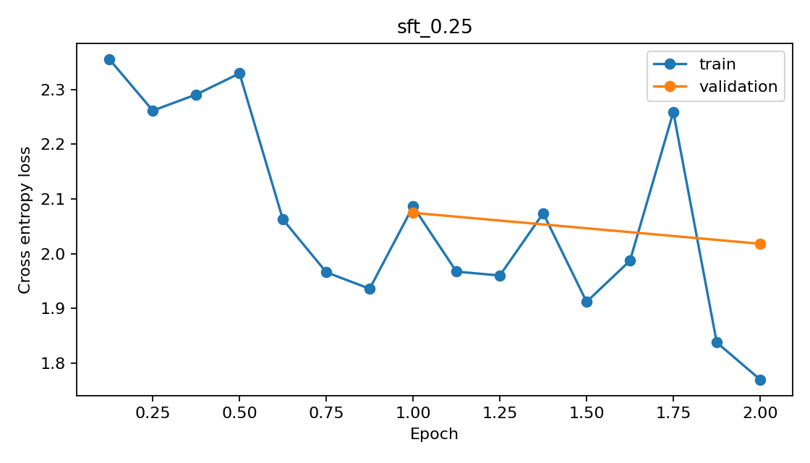
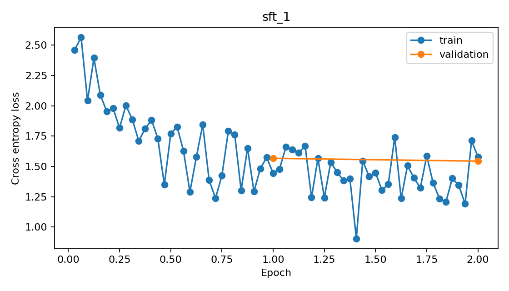

# 实验结果（仅包含实际完成的运行）

|model|prompt|rag|split|n|token_f1|rouge_l|seconds|
|---|---|---|---|---|---|---|---|
|sft_0.25|concise|False|test|64|0.5601729358365002|0.5401568047965564|21.272497800004203|
|sft_0.25|concise|True|test|64|0.5660590222136402|0.5357299394487377|20.694933599996148|
|sft_0.25|grounded|False|test|64|0.4780793505714409|0.4454904366598938|34.71149439999135|
|sft_0.25|grounded|True|test|64|0.5117239592913205|0.47553234749501055|27.077695499989204|
|sft_1|concise|False|test|64|0.5711071007912396|0.5566422423339242|18.83590109999932|
|sft_1|concise|True|test|64|0.5522145046941321|0.5290635390161303|19.192129200004274|
|sft_1|grounded|False|test|64|0.5415105674939792|0.5153782439166894|23.046257299996796|
|sft_1|grounded|True|test|64|0.5356975854060022|0.5059571123341997|21.891797300006147|
|zero_shot|concise|False|test|64|0.4876665641060101|0.4628404850092195|22.663255899999058|
|zero_shot|concise|True|test|64|0.49649617303285654|0.4591200381075172|22.278792599987355|
|zero_shot|grounded|False|test|64|0.4423536087434695|0.4027702268566169|27.686269400001038|
|zero_shot|grounded|True|test|64|0.46256302464756643|0.4179871772215851|24.982737999991514|

## 相对相同提示词/RAG设置的 zero-shot 差异

图像级配对 bootstrap，2000 次，95% 百分位区间；不作多重比较校正，不代表跨训练种子的变异。

|Model|Prompt|RAG|Token-F1 Δ|95% CI|
|---|---|---|---|---|
|sft_0.25|concise|False|0.0725|[0.0436, 0.1008]|
|sft_0.25|concise|True|0.0696|[0.0397, 0.1006]|
|sft_0.25|grounded|False|0.0357|[0.0162, 0.0575]|
|sft_0.25|grounded|True|0.0492|[0.0207, 0.0783]|
|sft_1|concise|False|0.0834|[0.0517, 0.1159]|
|sft_1|concise|True|0.0557|[0.0196, 0.0937]|
|sft_1|grounded|False|0.0992|[0.0664, 0.1335]|
|sft_1|grounded|True|0.0731|[0.0392, 0.1074]|

## 输出变化样例

以下按 Token-F1 变化选取两端样本，仅解释词汇指标变化，不将参考答案中未出现的内容自动判为幻觉。

- 图像 `cdd5c28cf2b5`（Δ -0.1769）
  - zero-shot: A busy street scene with people walking and shopping in a foreign country.
  - SFT: A man and woman walk down a street with a manhole cover in the foreground .
  - 参考之一: A busy city street with many people walking along it .

- 图像 `2d0e88d70dfb`（Δ -0.1600）
  - zero-shot: A dog is playing in the water, splashing around and holding a stick in its mouth.
  - SFT: A dog is playing in the water .
  - 参考之一: A dog is fetching a stick from a lake .

- 图像 `57dfa9ee2d99`（Δ 0.3187）
  - zero-shot: A large alligator is wading through shallow water, with its front legs raised and tail visible.
  - SFT: A large alligator is in the water .
  - 参考之一: The iguanas wrestled along the rocky water bank .

- 图像 `080b9fc1f589`（Δ 0.3866）
  - zero-shot: A bird with outstretched wings is flying over a grassy field.
  - SFT: A bird is flying with its wings spread .
  - 参考之一: A bird flying in the air

## CLIP retrieval

```json
{
  "image_to_text": {
    "R@1": 0.9375,
    "R@5": 1.0,
    "R@10": 1.0
  },
  "text_to_image": {
    "R@1": 0.834375,
    "R@5": 0.996875,
    "R@10": 0.996875
  },
  "test_images": 64,
  "test_captions": 320,
  "model": "D:\\Project\\CLIP\\data\\models\\clip-vit-base-patch32"
}
```






